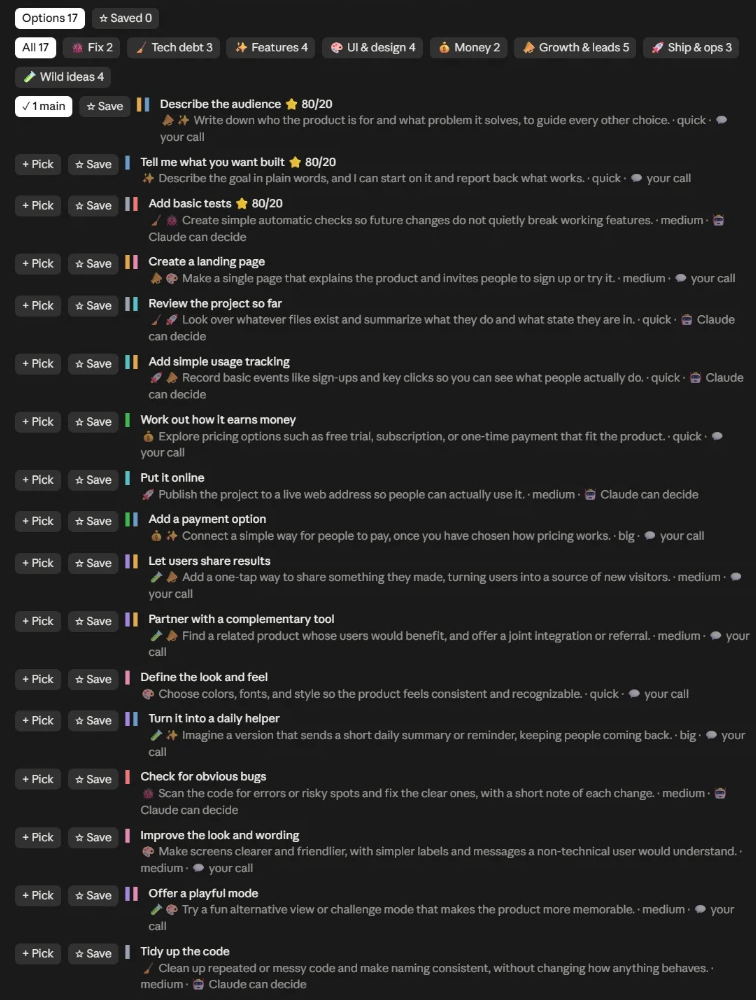

# Claude Code mods

Two small mods for [Claude Code](https://claude.com/claude-code) that make it easier to see what Claude is doing and to decide what to do next.

| Mod | What you get |
| --- | --- |
| **recap** | After Claude finishes a real piece of work, a side pane lists 28–40 possible next moves, color-coded by direction and ranked 80/20. Pick a few and it writes your next prompt for you. It also writes plain progress notes and a progress page for your clients. |
| **turn-status** | A quiet one-line band above the prompt while Claude works: what it is doing right now, how long it has been going, task progress and failures. It hides itself when Claude is idle. |

## Install

In a terminal, start `claude` and paste the line for the mod you want:

```
/plugin install recap --marketplace lokki007/claude-code-mods
```

```
/plugin install turn-status --marketplace lokki007/claude-code-mods
```

Claude Code asks whether to add the marketplace: answer `y`, then press Enter to install it for your user. The mod works straight away in that terminal session, and in every new chat after that, including the desktop app's Code tab. Restart chats that were already open.

> The desktop app's Code tab can't run `/plugin install` itself; install once from a terminal and the desktop app picks it up.

Needs a recent Claude Code (one that supports hooks-module plugins, 2.1.29x or later).

## recap: your next-prompt builder



*The ✨ Next pane in the Claude desktop app, beside the chat: 17 options, filterable by direction, ranked 80/20, each with **+ Pick** and **☆ Save**.*

When a turn edits files or digs through research, the **✨ Next** pane opens beside the chat:

- **One line of status**: 💚 done, 🟡 in progress or 🟥 blocked, plus a one-sentence summary.
- **✉ Explain to client**: a short, jargon-free note about the latest work (what changed, status, what is next), with a **Copy** button for your email or chat.
  - Choose the tone: **Friendly**, **Formal** or **Very short**, remembered per project.
  - Add the client's name and your sign-off once per project. The note greets them and signs off for you, and the progress page uses the name too.
  - **🧸 Even simpler** rewrites the note so anyone could follow it; press it again for the normal version.
- **Many options, not just one**: Claude looks at everything it saw (bugs, loose ends, shortcuts, missed chances), thinks about what your customers would value, and offers 28–40 next moves across eight directions:

  | | Direction | | Direction |
  |---|---|---|---|
  | 🐞 | Fix | 💰 | Money |
  | 🧹 | Tech debt | 📣 | Growth & leads |
  | ✨ | Features | 🚀 | Ship & ops |
  | 🎨 | UI & design | 🧪 | Wild ideas |

  Each option has a colored bar per direction it serves, a rough size (quick, medium, big), and whether it needs your ideas (💬) or Claude can decide it alone (🤖).
- **80/20 ranking**: the best value for the effort comes first; moves that help several directions at once rank higher, and the top three wear **⭐ 80/20**. Click a direction to see only its options.
- **Borrowed ideas**: ideas you picked and ran in your other projects are offered again where they fit, marked **↪ borrowed from** that project.
- **It learns, gently**: after a few prompts it notices which directions you usually pick and nudges them up a little, never hiding the rest. **Reset learning** clears it.
- **Save for later**: **☆ Save** keeps an option in the **Saved** tab for that project, across chats, so you can pick from it any time (`/recap` opens it).
- **Build the prompt**: press **+ Pick** on a few options. The first is the main job, the rest ride along. Choose **Where** (keep it local, staging, production) and **Questions**:
  - **Interview me first**: Claude asks up to five plain-language multiple-choice questions *in the pane*; click your answers and press **Send answers**. You are never asked technical questions.
  - **Just do it**: no questions, Claude decides and tells you what it chose.
  - **Auto**: interviews you only when a pick needs your ideas.
- **Send it**: **Put in prompt**, **Add to my draft** or **Send now ▶**. **A− / A+** change the text size, and your choices are remembered.

It also keeps track for you:

- **Never left guessing**: when a turn gets no pane, a short note says why ("nothing was changed, it was just a chat") and that `/recap` makes one anyway.
- **The latest recap per project**: `/recap` in any chat of the same project shows it straight away; **↻ New options** brews fresh ones for that chat.
- **A gentle reminder**: open a chat on a project whose last piece of work was left 🟡 or 🟥, and the owl names it with one next step.
- **A progress diary per project**: each finished recap adds a dated update written for clients: the outcome in plain words, the status and what comes next. File names and technical terms are taken out, and what is left still reads as a normal sentence.
- **A progress page to share**: the diary is also kept as a clean, private web page, updated with every new entry. Send the file to your client; it has no tracking and no outside links.
- **A calm owl**: after two or three finished pieces of work in a row it wears a small medal; after four or more it quietly glows.
- **A log for debugging**: every attempt, whether it worked and why, in `~/.claude/recap/log.jsonl` (`/recap log`).
- **A plain warning** if two copies of the mod end up loaded in one chat, instead of failing quietly. turn-status does the same.

Commands: `/recap` opens the pane, `/recap again` brews fresh options, `/recap diary` and `/recap page` show the progress updates (`page` is the web page), `/recap client Name` and `/recap signoff Name` set them for the project (handy on the phone, where the pane has no text box), and `/recap log` shows the debug log. Newer Claude versions have a built-in `/recap`. There, every one of these starts with `/next` instead, the mod tells you once, and every message it shows names the command that works. Runs with no screen (`claude -p`, scripts) get no recap, so they stay fast; `RECAP_HEADLESS=1` turns it back on.

What's next for it: a [daily digest across all your projects](docs/daily-digest-sketch.md) (a sketch).

How it works: the options come from a short follow-up question to Claude about the conversation that just happened, so they can point at real code. It costs a little extra per qualifying turn (most of the conversation is served from the prompt cache); if that fails it falls back to the small, fast model.

## turn-status: a quiet live status band

While Claude works, one row above the prompt shows:

```
⟳ Building the status band   Running npm test   1:46   ▬▬▬▬▬ 1/5   ● 1 failed
```

- what Claude is doing in plain words (the current task when it keeps a task list, else "Editing svg.ts", "Running npm test", "Thinking")
- a timer whose digits roll over like an odometer
- task progress, one segment per task, when there is a task list
- a red count when a tool fails

When the turn ends it shows "✓ Done in 1:46" for a few seconds and then gets out of the way. In the desktop app it is drawn as a small animated graphic; in a terminal, as text.

## For tinkerers

Each mod is a [Claude Code hooks-module plugin](https://code.claude.com/docs) under `plugins/<mod>`: `hooks/register.tsx` is the entry point, `types/index.d.ts` declares the state it keeps, and `hooks/*.test.ts` are its tests. Run them with:

```
claude plugin validate plugins/recap
claude plugin test plugins/recap
```

To work on a mod locally, add this folder as a marketplace once (`claude plugin marketplace add <path to this repo>`), install from it, then release changes with:

```
node scripts/release.mjs recap [patch|minor|major] [--stage | --publish]
node scripts/release.mjs promote
```

It bumps the version, copies in the shared test helpers (`shared/`), validates and tests, commits the release, refreshes the installed copy and prunes old cached copies.

- `--stage` pushes to the `staging` branch and checks a fresh install from it on GitHub.
- `promote` moves staging to the public version and checks a fresh install again.
- `--publish` pushes straight to the public version.

Other scripts:

- `node scripts/nightly-check.mjs` runs a short headless chat with both mods and checks their logs. `--install` runs it every night at 3am and pops up a Windows notification if anything failed.
- `node scripts/demo-gif.mjs <folder of screenshots>` makes the README demo GIF.
- `node scripts/sync-shared.mjs` copies the shared test helpers into each mod.

## License

MIT
